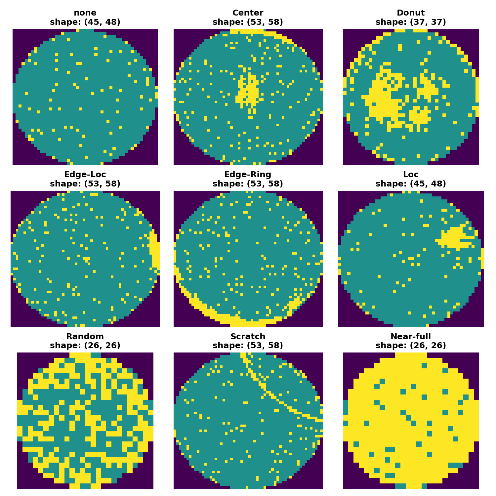
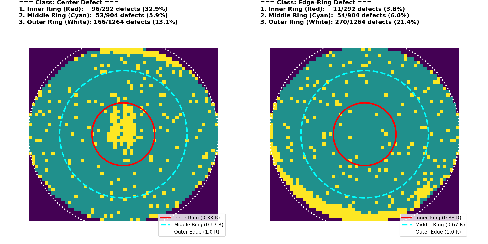
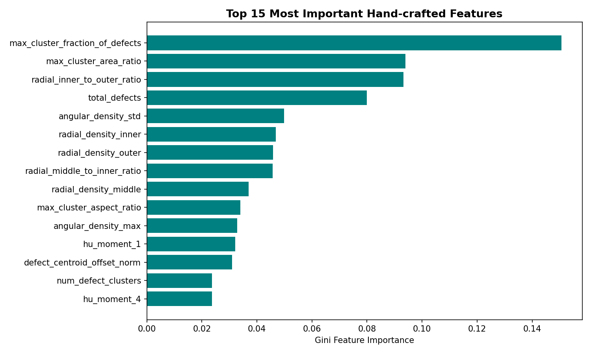
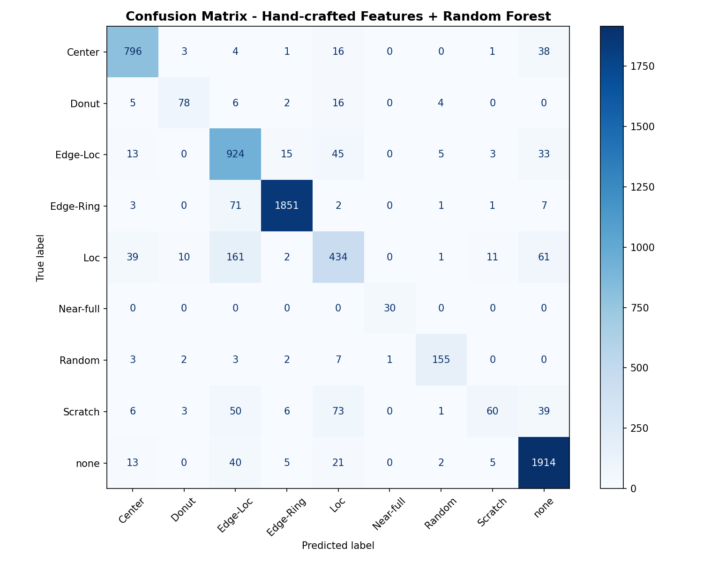
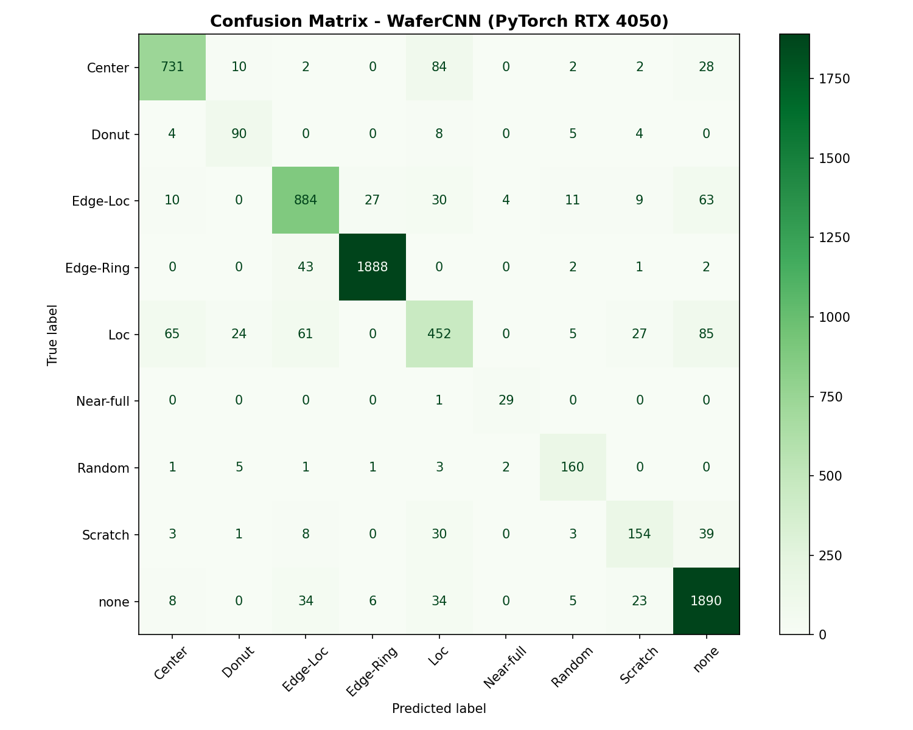
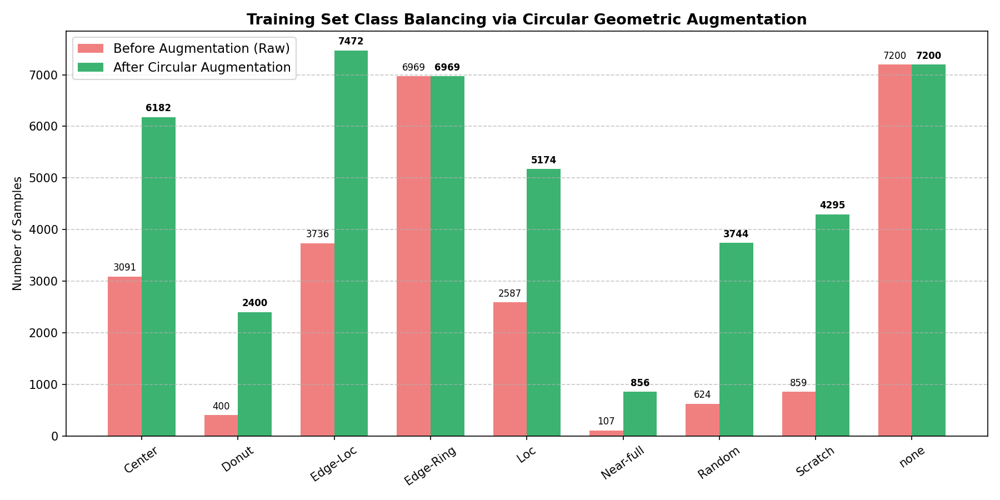
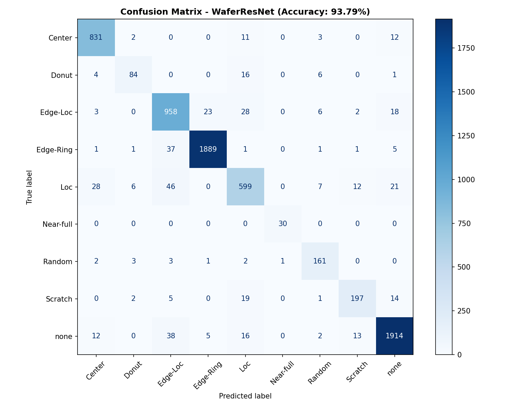
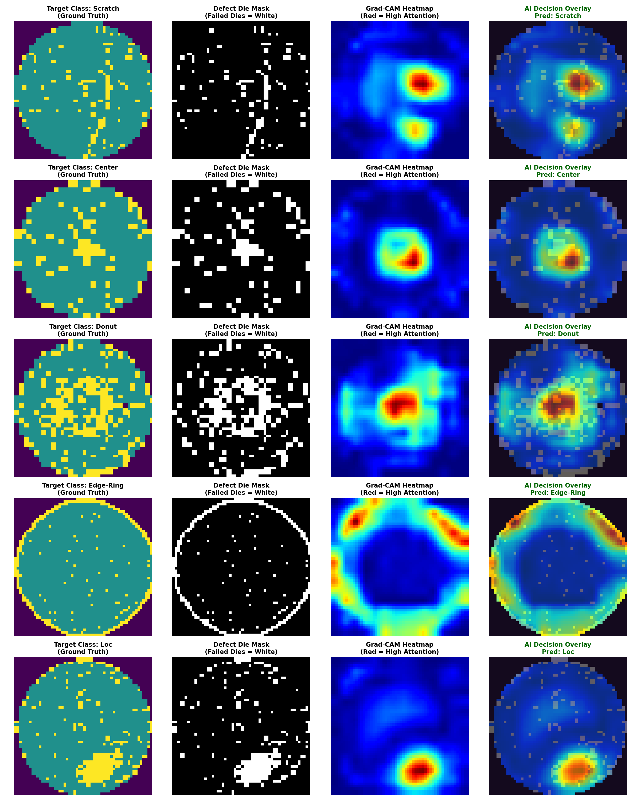

# Wafer Map Defect Pattern Classification (WM-811K)

[](https://www.python.org/)
[](https://pytorch.org/)
[](https://www.kaggle.com/datasets/qingyi/wm811k-wafer-map)

This repository implements a 9-class wafer map defect classification pipeline on the **WM-811K dataset** (811,457 real-world semiconductor wafer maps). The project compares a handcrafted geometric feature baseline (Random Forest) against Convolutional Neural Networks (`WaferCNN` and `WaferResNet`), analyzing why bounding-box geometry fails on diagonal scratches and verifying model predictions using **Grad-CAM**.

---

## 🧭 Project Workflow

```
[ 1. Data Exploration & Cleaning ]
       │  Filtered 78.7% unlabeled data; handled severe class imbalance & variable grid sizes
       ▼
[ 2. Discrete-State Preprocessing ]
       │  Used Nearest-Neighbor (cv2.INTER_NEAREST) & 3-channel One-Hot encoding for states {0, 1, 2}
       ▼
[ 3. Geometric Feature Baseline (Random Forest) ]
       │  Extracted 29 features (8 concentric rings, 8 octants, Hu moments, bounding box)
       │  Result: 87.87% accuracy, but Scratch recall was only 25.21%
       ▼
[ 4. Convolutional Neural Network (WaferCNN) ]
       │  3 Conv blocks + Global Average Pooling to capture local spatial strokes
       │  Result: 88.37% accuracy, Scratch recall improved from 25.21% -> 64.71%
       ▼
[ 5. Residual Network (WaferResNet) ]
       │  Residual skip connections + rotation/flip augmentation + class-weighted loss
       │  Result: 93.79% accuracy (90.88% Macro F1), Scratch recall reached 82.77%
       ▼
[ 6. Model Explainability (Grad-CAM) ]
          Generated spatial attention heatmaps to verify the model focuses on actual defect structures
```

---

## 1. Dataset Characteristics & Preprocessing

Inspecting `LSWMD.pkl` (811,457 wafer maps) revealed three main challenges:
1. **Unlabeled Samples:** **638,507 wafers (78.7%)** have no labels, leaving **172,950 labeled wafers** across 9 classes.
2. **Severe Class Imbalance:** Normal wafers (`none`) account for 147,431 samples, whereas `Scratch` has only 1,193 samples and `Near-full` has 149 samples.
3. **Variable Grid Dimensions:** Wafer maps vary in size (e.g., $26 \times 26$ up to $60 \times 60$).


*Figure 1: The 9 wafer map classes in WM-811K: Center, Donut, Edge-Loc, Edge-Ring, Loc, Random, Scratch, Near-full, and Normal (none).*

### Why Nearest-Neighbor Resizing (`cv2.INTER_NEAREST`)?
Wafer maps are not standard grayscale photos; each pixel is a discrete categorical value:
- `0`: Empty background (outside wafer circle)
- `1`: Normal die (passed test)
- `2`: Defective die (failed test)

Resizing with bilinear or bicubic interpolation blends `1` and `2` into fractional numbers like `1.42`, distorting the discrete grid data. Using `cv2.INTER_NEAREST` preserves exact categorical values before converting each map into a 3-channel One-Hot tensor ($3 \times 56 \times 56$).

---

## 2. Baseline 1: 29 Geometric Features + Random Forest

Since wafer defects follow distinct geometric shapes (rings, central clusters, edge arcs), I started by extracting **29 handcrafted features** (`src/features.py`):
- **8 Concentric Ring Densities:** Defect density ratios from the center outward to the perimeter.
- **8 Directional Octants:** Dividing the wafer into $45^\circ$ sectors to capture localized edge/cluster defects.
- **Centroid Offset:** Distance from the wafer center to the defect center of mass.
- **Hu Moments (7 features):** Shape descriptors invariant to rotation and scale.
- **Bounding Box Geometry:** Aspect ratio ($W/H$) and area fill ratio of the largest connected defect component.


*Figure 2: Visualization of the 8 concentric ring masks and 8 directional octant masks.*

Training a **Random Forest** classifier on these 29 features achieved **87.87% overall test accuracy**:


*Figure 3: Random Forest feature importance ranked by outer ring and octant densities.*

### Limitation: Why Geometric Features Failed on Scratches
Despite the 87.87% overall accuracy, the confusion matrix showed a major weakness on the `Scratch` class:


*Figure 4: Random Forest confusion matrix — `Scratch` recall reached only 25.21%.*

**Cause of the failure:**
A horizontal or vertical scratch produces a narrow bounding box with a high aspect ratio ($W/H \gg 1$ or $\ll 1$). However, a **diagonal scratch at $45^\circ$** has a nearly square bounding box ($W \approx H$, aspect ratio $\approx 1.0$), making it indistinguishable from a localized cluster (`Loc`) when using bounding-box summary statistics.

---

## 3. Baseline 2: Plain CNN (`WaferCNN`)

To capture thin continuous lines at any angle without relying on bounding-box ratios, I trained a 3-block Convolutional Neural Network (`WaferCNN`):
- 3 Conv blocks ($32 \rightarrow 64 \rightarrow 128$ channels) with BatchNorm and ReLU
- Global Average Pooling (GAP) + 2-layer classifier with Dropout (0.3)


*Figure 5: `WaferCNN` confusion matrix — `Scratch` recall improved from 25.21% to 64.71%.*

- **Overall Accuracy:** 88.37%
- **Scratch Recall:** Increased from **25.21% $\rightarrow$ 64.71%** (+39.5% improvement)

---

## 4. Improving Fine-Line Detection with `WaferResNet`

While `WaferCNN` improved scratch detection significantly, ~35% of scratches were still missed because 1-pixel-wide scratch lines weaken during spatial downsampling, and rare defect classes suffer from severe data imbalance.

To address this, I trained **`WaferResNet`** along with targeted training strategies:
1. **Residual Skip Connections:** Preserve fine spatial signals across deeper convolutional blocks so 1-die-wide scratch lines are not lost.
2. **Rotation & Flip Augmentation:** Applied valid geometric transformations ($90^\circ, 180^\circ, 270^\circ$ rotations and horizontal/vertical flips) to minority defect classes.
3. **Class-Weighted Cross-Entropy Loss:** Penalized misclassification on underrepresented defect classes during training.


*Figure 6: Class distribution before and after applying rotation and flip augmentations to minority defect classes.*


*Figure 7: `WaferResNet` confusion matrix achieving 93.79% test accuracy and 82.77% Scratch recall.*

### Model Comparison Summary

| Model | Approach | Test Accuracy | Macro F1 | Scratch Recall |
| :--- | :--- | :---: | :---: | :---: |
| **Random Forest** | 29 Handcrafted Geometric Features | 87.87% | 81.07% | 25.21% |
| **WaferCNN** | 3-Layer CNN + GAP | 88.37% | 83.03% | 64.71% |
| **WaferResNet** | Residual Blocks + Augmentation + Weighted Loss | **93.79%** | **90.88%** | **82.77%** |

---

## 5. Visual Verification with Grad-CAM

To verify that `WaferResNet` classifies defects based on actual defect geometry rather than random background noise dies, I applied **Grad-CAM** (`src/explainability.py`) to visualize activations from the final residual layer:


*Figure 8: Grad-CAM visualization across defect classes. Column 1: Original wafer map. Column 2: Defective dies. Column 3: Grad-CAM heatmap. Column 4: Overlay on the wafer map.*

The heatmaps confirm that the network attends directly to the relevant structures—tracing along the thin stroke for `Scratch`, the outer perimeter for `Edge-Ring`, the hollow ring for `Donut`, and the central cluster for `Center`.

---

## 🛠️ How to Run

### 1. Environment Setup
```bash
git clone https://github.com/teeranon124/WM-811k-WaferMap.git
cd WM-811k-WaferMap

python -m venv .venv
.\.venv\Scripts\activate      # Linux/Mac: source .venv/bin/activate
pip install -r requirements.txt
```

### 2. Dataset Setup
Download `LSWMD.pkl` from Kaggle's [WM-811K Wafer Map Dataset](https://www.kaggle.com/datasets/qingyi/wm811k-wafer-map) and place it in `data/LSWMD.pkl`.

### 3. Run Training & Evaluation Scripts
```bash
# 1. Preprocess dataset and generate train/val/test splits
python scripts/prepare_dataset.py

# 2. Train and evaluate the 29-feature Random Forest baseline
python scripts/train_handcrafted_rf.py

# 3. Train and evaluate WaferCNN and WaferResNet
python scripts/train_cnn.py
python scripts/train_resnet.py

# 4. Generate Grad-CAM visualization plots
python scripts/generate_gradcam_demo.py
```
